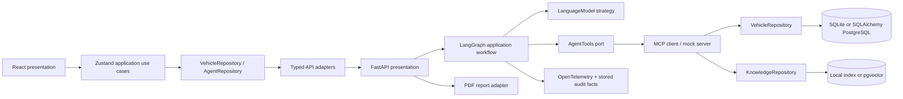
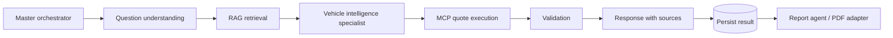

# AUTONEX AI architecture

AUTONEX separates domain values, application workflows, infrastructure adapters and HTTP/React presentation. Adding a brand changes catalog/document inputs, not the workflow topology. Adding an authorized partner requires a new tool adapter and authorization policy; the mock connector never silently becomes live.

## Responsibilities

- `frontend/src/domain`: Zod contracts, TypeScript values and repository ports.
- `frontend/src/application`: race-safe quotes, configuration, request history and streaming state. Overlapping agent requests are prevented.
- `frontend/src/infrastructure`: HTTP validation and streaming NDJSON decoding.
- `frontend/src/app/composition.ts`: automatic frontend adapter selection. `infrastructure/workspace.ts` checks all startup API resources atomically, then selects FastAPI or the bundled `BrowserWorkspace` adapter. Browser mode shares repository ports and never claims live LLM/MCP execution.
- `frontend/src/infrastructure/demo`: typed local fixture access, validated quotes, deterministic assistant, source search, bounded device persistence and local operation metrics. Components never import fixture data directly.
- `frontend/src/features/vehicle`: render-only Three.js scene and concept geometry. Props carry paint, body type, camera rotation and interior mode.
- `backend/src/autonex/domain`: immutable Pydantic values and pricing rules; no HTTP/SQL/LLM imports.
- `backend/src/autonex/application`: typed LangGraph workflow, repository protocols, retry policy and tool use cases.
- `backend/src/autonex/infrastructure`: LangChain provider strategy, deterministic strategy, MCP transport, RAG/vector adapters, persistence and reports.
- `backend/src/autonex/api`: composition and HTTP delivery. CORS, concurrency/deadline handling, streaming and sanitized errors.

Adapters are injected into use cases. A catalog estimate is computed from validated server-side option IDs; an LLM cannot invent an option or set a price. Retrieved sources are treated as data and citations must reference retrieved IDs. Citation validation checks identity, not comprehensive semantic entailment; see RAG.md.

## Workflow

The specialist routes to performance, comfort or value based on typed intent. Provider calls retry once, then fail. The total deadline and semaphore bound execution. Checkpoints are in memory during one run and are released after completion/cancellation. Run payloads and recorded metrics survive restarts. Durable resumable checkpoints, approval interrupts and distributed job queues are future production extensions.

## API

Base path: `/api/v1`. Interactive schemas: `/docs`; raw schema: `/openapi.json`.

| Method / path                  | Purpose                                              |
| ------------------------------ | ---------------------------------------------------- |
| `GET /health`                  | Active mode/model/retrieval strategy                 |
| `GET /vehicles`                | Demo catalog                                         |
| `GET /vehicles/{id}`           | Single catalog fixture                               |
| `POST /quotes`                 | Validate IDs and compute a demo estimate             |
| `GET /knowledge`               | Source documents and content versions                |
| `POST /agent/runs`             | Complete a bounded workflow; 201 and request ID      |
| `POST /agent/runs/stream`      | NDJSON step events, then result or sanitized error   |
| `GET /agent/runs/{id}`         | Persisted result                                     |
| `GET /agent/runs/{id}/report`  | Source-attributed PDF                                |
| `GET /operations`              | Recorded aggregates and 50 most recent audit records |
| `POST /service-centers/search` | Search virtual centers through MCP                   |
| `POST /service-requests/demo`  | Simulate a service request through MCP               |
| `POST /test-drives`            | Save a local, consent-based interest record          |
| `/mcp/`                        | Streamable HTTP mock MCP server                      |

Invalid input returns 422, missing resources 404, saturation 429, provider/tool failure 502 and deadline 504. Streaming failures after headers are sent use a terminal `error` event. Successful stream events describe completed nodes, not invented progress percentages or hidden chain of thought.

## Scope

The default local storage and PostgreSQL adapter implement the same repository seam. API health indicates mode and process availability, not all remote provider health. There is no authentication or multitenancy in this demonstration. Keep the API private. Production authorization belongs at the API and tool adapter boundaries.
